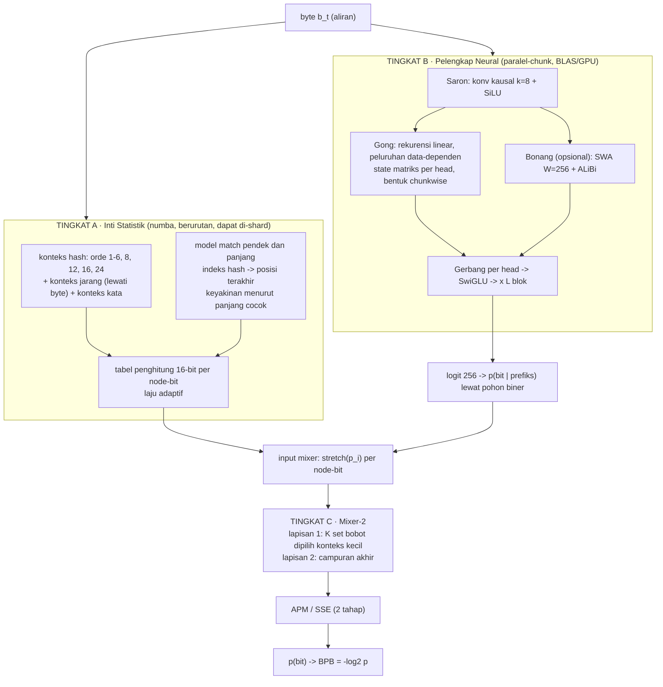

# Arsitektur TMT2 v2 — Inti Statistik + Pelengkap Neural Paralel-Chunk

**Status: RANCANGAN + HASIL (diperbarui 2026-10-06).** Rancangan di §4 sudah **diimplementasikan
dan diukur**; setiap bagian kini punya angka **[terukur]**. Ringkasan hasil: Tingkat A **jalan &
menang atas semua kompresor umum** (Indonesia 30 jt byte: 2,1865 vs lzma 2,2680), tetapi menghadapi
**kurva-U** (§11); Tingkat B **gagal G2** pada skala penuh (§4.2/§7). Angka bertanda **[hipotesis]**
masih anggaran yang belum dibuktikan. Rincian kronologis di `STATUS.md`, konsolidasi di
`DOKUMENTASI_LENGKAP.md`, masalah terbuka di `MASALAH_SAAT_INI.md`.

---

## 1. Titik awal (apa yang sudah terukur)

| # | fakta | sumber |
|---|---|---|
| 1 | Seluruh kualitas datang dari **mixer n-gram**. Mixer-saja 1,8434; mixer+SSM 1,8440; SSM-saja 2,9235 (WikiText 200k, seed 0) | LAPORAN §18.4 |
| 2 | State SSM ≈ **n-gram orde 2,5**. Transisi `h = a⊙h + (1-a)⊙u` adalah filter-bank low-pass tanpa pencampuran antar-saluran, jadi tak bisa menyimpan fitur lokal tajam | §18.1, §18.8 |
| 3 | WikiText: TMT2+mixer 1,8264, menang atas semua baseline termasuk bz2 -9 kondisional (1,945). **Indonesia: 2,4809, KALAH dari bz2 (2,370) dan lzma (2,404)** pada semua jendela. Penyebab yang dicurigai: ulangan jarak jauh yang tak terjangkau orde ≤12 | §19.1 |
| 4 | Kecepatan: **8.054 B/s @d=32** (kernel terpadu). Plafon ≈10–12k B/s karena jejak RTRL `3·d²` ≈55% waktu mundur. 100M byte ≈ 3,4 jam | STATUS rev. 7 |
| 5 | Tidak menolong: smoothing KN, multi-epoch, `mixer_lr_mult`, `mixer_init`, readout berkapasitas lebih besar, gradien yang lebih benar | §18.7 |
| 6 | Gate 2 (nilai SSM) **memblokir**: butuh ≥ +0,05 bit di atas mixer pada ≥1M byte, tidak mengecil saat data tumbuh | §19.2 |

Dua hal yang **belum terukur** dan menentukan rancangan ini:

* Benchmark 8.054 B/s tidak menyebut apakah mixer orde 1..12 + match ikut aktif. Mixer saat ini
  bertingkat-simbol: tiap orde menghasilkan vektor 256 log-probabilitas dari tabel `dict` Python.
  Biaya per byte `Config.best()` dengan mixer menyala **belum dipisah dan diprofil**.
* Efek skala data. Mixer turun dari 2,16 (100k) ke 1,84 (200k), tetapi tidak ada kurva 1M–100M.

## 2. Penilaian Gamelan

Gamelan (blok: Saron/Bonang/Gong/Kenong → Gerbang per head → Dalang+LoRA-experts; kepala LM,
Kendang, Penonton) adalah rancangan komposisi dari komponen yang sudah dikenal (Mamba-2/RetNet/
Griffin/DeepSeekMoE). Pernyataan penulisnya sendiri: tidak ada model yang dilatih, tidak ada
perplexity. Yang diverifikasi adalah **identitas matematis dan konsistensi implementasi**
(rekuren = chunkwise 4e-16, paralel = decode 3e-15, speculative decoding lossless).

Pelajaran yang sama sudah dialami TMT2: RTRL eksak, gradien eksak, kernel bit-identik, namun SSM
menyumbang 0,000 bit. **Eksaktitas tidak membuktikan kegunaan.** Karena itu Gamelan diperlakukan
sebagai sumber **hipotesis dan teknik uji**, bukan sebagai bukti kualitas.

Catatan: uji recall Gamelan sendiri menunjukkan Gong ≈ 0,01 pada 16k pasangan KV, jadi Gong **bukan**
mesin recall. Recall dikerjakan Kenong (VQ-IVF), yang tak berhasil diuji dengan kunci terlatih.

## 3. Pemetaan: masalah terukur → komponen yang diambil

| masalah TMT2 (terukur) | komponen Gamelan | keputusan | alasan |
|---|---|---|---|
| Kecepatan terkunci RTRL `3·d²`, satu aliran berurutan | **Gong** (dualitas rekuren↔chunkwise) | **AMBIL**, ganti SSM diagonal | latihan jadi matmul per-chunk (BLAS numpy/GPU), tanpa jejak RTRL, bisa batch multi-aliran |
| SSM tak punya fitur lokal tajam (orde-2,5) | **Saron** (konv kausal k=8 + SiLU) | **AMBIL** | fitur n-gram terpelajar, generalisasi pada konteks jarang yang tak bisa dilakukan tabel hitung |
| Kalah dari bz2/lzma pada korpus repetitif | **Bonang** (SWA+ALiBi) dan **Kenong** (indeks jarak jauh) | **Model match dulu** (non-neural); Bonang opsional di belakang gerbang | ulangan jarak jauh dicakup murah oleh indeks hash; Bonang hanya jika terbukti menambah |
| Bobot mixer global (`mix_w`, 12 skalar) | **Gerbang per head / Dalang** | **AMBIL versi ringan**: set bobot dipilih konteks kecil + mixer 2-lapis + APM | sama dengan mixer PAQ; bukan MoE penuh |
| Tabel mixer tumbuh linear dengan data | **Aturan presisi** (state FP32, basis presisi rendah) | **AMBIL**: tabel 16-bit, state saraf FP32 | memori dan bandwidth cache |
| Perlu bukti bahwa jalur paralel = jalur sekuensial | **Tes dualitas** | **AMBIL sebagai regresi wajib** | tradisi TMT2: acuan eksak sebelum jalur cepat |
| Hipotesis tanpa kriteria gugur | **"Hipotesis yang bisa dibantah"** | **AMBIL** sebagai gerbang pra-terdaftar (§7) | sejalan dengan Gate 2 |

**Sengaja TIDAK diambil** (tak ada masalah terukur yang mereka selesaikan, dan menambah permukaan bug):
Dalang MoE penuh dan LoRA-experts (untuk model berparameter miliaran), Kendang (drafter difusi), Penonton
(GAN), DPO/RLHF, kuantisasi INT4/FP8, VQ-VAE untuk KV. Satu pengecualian untuk nanti (M6): *speculative
decoding terbalik*, dengan Tingkat A sebagai drafter murah dan Tingkat B sebagai verifier, untuk generasi.

## 4. Arsitektur v2

Prinsip: **pisahkan menurut karakter komputasi**. Statistik hitung = berurutan, tabel, cache-bound.
Neural = paralel di sepanjang waktu (teacher-forcing), matmul-bound. Keduanya digabung di akhir oleh
mixer yang kecil dan eksak gradiennya.



### 4.1 Tingkat A — Inti Statistik (`tmt2/stat_core.py`, numba)

* **Dekomposisi biner.** Satu byte = 8 keputusan biner (untuk `vocab=4096`: 12). Tiap input memberi
  `p_i`, masukan mixer `stretch(p_i) = ln(p_i/(1-p_i))`. Biaya per byte `O(bit × input)`, bukan
  `O(V × orde)` seperti mixer bertingkat-simbol sekarang.
* **Tabel**: hash terbuka dengan checksum 8-bit, penghitung 16-bit dengan laju adaptif (cepat untuk
  konteks baru, lambat untuk yang stabil). Array datar, nol alokasi per byte.
* **Konteks**: orde 1–6, 8, 12, 16, 24; konteks jarang (mis. byte t-2,t-3 tanpa t-1); konteks kata
  (huruf sejak pembatas terakhir). Daftar akhir ditentukan sapuan, bukan diasumsikan.
* **Model match** (menggantikan `logprior_match` yang hanya deterministik): indeks hash untuk
  MINLEN pendek dan panjang → posisi terakhir; byte prediksi diubah menjadi masukan dengan
  keyakinan yang dipelajari per panjang-cocok. Target spesifik: korpus Indonesia (§19.1).
* **Dua mode tabel**: (a) *adaptif* untuk online; (b) *hitung aditif* (dapat digabung antar-shard)
  untuk pelatihan skala besar. Ini risiko rancangan, lihat §9.
* Mixer bertingkat-simbol yang ada dipertahankan sebagai **acuan** (padanan `autograd.py`) untuk tes.

**Implementasi terukur (2026-10-05/06) — dua cacat diperbaiki:**

| # | cacat | bukti | perbaikan |
|---|---|---|---|
| 1 | **checksum match = bit indeks** (`mck = mkey & 255`, padahal `msl = mkey & mmask` juga bit bawah) → verifikasi match **selalu benar** | **100% dari 299.994 sampel** | `mck = (mkey >> 40) & mck_mask` |
| 2 | **indeks konteks `c` tak ikut di-hash** → dua konteks berbeda bertabrakan & saling menimpa | kapasitas efektif turun | `key = _mix64(hctx[c] ^ c0*GOLDEN ^ (c+1)*CCTX)` |

Keduanya dijaga flag `match_fix` / `ctx_fix`. **Efek gabungan −0,0616 bit** (tb=22, 5 jt byte:
2,6371 → 2,5755). Akurasi match 0,541 → 0,587.

**Parameter baru** (semua jadi argumen fungsi `stat_step`, **bukan** konstanta tingkat-modul —
karena numba membekukan konstanta modul saat kompilasi; lihat jebakan di STATUS §20.5):
`count_cap` (ambang pangkas penghitung, default 1023), `cks_bits` (lebar checksum konteks,
default 24), `match_fix`, `ctx_fix`, `match_ck_bits`.

**`table_bits` produksi = 26** (bukan 25). Bukti: pada 14 jt byte, tb=26 CE **1,978 masih turun**
vs tb=25 2,048 **sudah berbalik naik**. Tabel 2× lebih besar menunda penimpaan (lihat §11).

### 4.2 Tingkat B — Pelengkap Neural (`tmt2/gamelan/`)

Satu blok, `L` blok ditumpuk, `d` kecil (mulai d=32, L=2 agar sebanding dengan TMT2 sekarang):

* **Saron**: konvolusi kausal (depthwise + pointwise) panjang 8 atas `E[b]`, SiLU. Fitur n-gram
  terpelajar. Hipotesis: berguna terutama di konteks jarang (data sedikit).
* **Gong**: `U_t = λ_t U_{t-1} + (1-λ_t) k̃_t v_tᵀ`, `o_t = q̃_t U_t`, dengan `λ_t` bergantung data,
  skala waktu `τ_h` per head tersebar geometris (mis. 2 … 4096). Latihan memakai bentuk chunkwise
  (chunk C=64): matmul intra-chunk dengan topeng peluruhan, state dibawa antar-chunk.
  Inferensi/generasi memakai bentuk rekuren O(1). **Risiko yang diketahui**: ia kerabat memori delta
  `M` yang sudah ada (d_mem=8), dan gagal sebagai alat recall di uji Gamelan sendiri. Varian aturan-delta
  (Gated DeltaNet, H3 di laporan) disiapkan sebagai alternatif.
* **Bonang (opsional, `use_window_attn`)**: perhatian softmax berjendela W=256, ALiBi dengan
  kemiringan `m_h = ln2/τ_h`. Aktif hanya bila gerbang G3 menunjukkan model match tak cukup.
* **Gerbang per head** mencampur keluaran Saron/Gong/Bonang. Lalu SwiGLU (expand 2), residual, RMSNorm.
* **Kepala**: `logits = W_out · norm(y)`. Catatan: temuan lama "l2norm wajib" berlaku untuk arsitektur
  lama; uji ulang, jangan diwariskan buta.
* **Presisi**: state Gong FP32; bobot FP32 pada CPU; BF16 hanya untuk matmul di GPU.
* **Keluaran ke Tingkat C**: `logits[256]` → `p(bit | prefiks)` lewat pohon biner 255 simpul
  (jumlah massa subpohon), diberikan sebagai satu atau dua masukan mixer (probabilitas + keyakinan).
* **Pelatihan**: BPTT *dalam chunk* (exact), stop-gradient antar-chunk, batch banyak aliran. Cross-entropy
  sendiri dulu (tahap 1); mixer dilatih setelahnya dengan neural sebagai masukan (tahap 2). Fine-tune
  gabungan hanya bila G2 lulus.
* **Independensi**: keluaran Tingkat B pada byte t hanya bergantung byte < t dan tidak bergantung
  mixer, sehingga pada penilaian (teacher-forced) seluruh chunk dihitung paralel lebih dulu.

**Hasil terukur (2026-10-05/06) — PUTUSAN G2: BELUM LULUS pada skala penuh:**

| pengukuran | hasil |
|---|---|
| B mandiri 250k/8k Indonesia (d=32, H=4, 5 epoch) | BPB **2,6654** (Tingkat A di korpus sama 2,3261 → **kalah 0,34 bit**); CE masih turun |
| **Integrasi A+B @1.000.000 byte** | A saja 3,2159 · A+B terlatih **3,2164 (Δ −0,0005)** · A+B acak 3,2161 (Δ −0,0001, **kontrol bersih**) · A+B kocok 3,2324 (Δ −0,0165) |
| kecepatan | ~1–3 kB/s (numpy float64 murni; butuh BLAS/GPU) |

→ Neural membawa **sinyal temporal** (mengocok urutannya merugikan 0,017) tetapi **tidak menambah
informasi** di atas tabel Tingkat A. Sesuai §7: **modul riset**, hasil negatif ditulis.

★ **Keruntuhan generasi.** Apa pun prompt-nya, setelah ~40 byte keluaran Tingkat B menjadi teks yang
**sama** (tarikan tetap). **Bukan bug train/eval**: jalur latih `block_forward_cache` dan jalur
generasi `blk.forward`/`step` terbukti menghitung fungsi **identik** (selisih 1,7e−15).

★ **Inisialisasi peluruhan.** `bl = 0` → λ = 0,5 untuk **semua** head → horizon awal ≈1 langkah,
padahal §4.2 di atas menuntut τ_h tersebar geometris. Sebaran diimplementasikan
(`bl_h = ln(τ_h−1)`, τ = geomspace(2,4096,H), parameter `tau_spread`) dan **diukur**:
**2,7300 vs 2,6654** → sedikit **lebih buruk**, dan **tidak** memperbaiki keruntuhan. Karena λ tetap
bergantung data (`h@wl`), model bisa belajar memisahkan skala sendiri; default = **False**
(pemenang terukur), flag tersedia. + tes regresi `test_tau_spread_geometric`.

**Belum dicoba**: `d`/`H` lebih besar · L>1 blok bertumpuk · latih lebih lama (CE masih turun) ·
Bonang (SWA+ALiBi) · backend BLAS/GPU.

### 4.3 Tingkat C — Mixer-2 dan APM (`tmt2/stat_core.py`)

* Lapisan 1: K set bobot, masing-masing dipilih konteks kecil berbeda (node-bit parsial `c0`,
  bucket panjang-match, byte sebelumnya, bucket keyakinan neural). Keluaran `squash(w_sel · x)`.
* Lapisan 2: campuran dari K keluaran lapisan 1.
* Pembaruan online: `w += η · (y − p) · x_i`. Gradien sederhana dan eksak → diverifikasi beda-hingga
  seperti `mix_w` sekarang (rel maks target < 1e-8).
* APM/SSE dua tahap (konteks orde-1 dan orde-2 ter-hash), interpolasi 33 ember, rata-rata akhir.
* Ini padanan "Gerbang/Dalang" yang diperlukan di skala ini. Ini teknik lama (PAQ), dan **tidak
  diklaim baru**.

## 5. Anggaran kecepatan

Titik awal: 8.054 B/s = 124 µs/byte (belum tentu termasuk mixer). Konversi: `B/s = 10⁶ / µs-per-byte`.
**Semua baris bertanda [hipotesis].** Fase M0 mengukur ulang baseline, M1–M4 mengukur tiap baris.

| komponen | µs/byte [hip.] | catatan |
|---|---|---|
| Tingkat A: 8 bit × ~16 lookup + pembaruan penghitung | 3 – 6 | numba, 1 inti, memori-bound |
| Tingkat C: mixer 2-lapis + APM | 1 – 2 | `bit × K × input` |
| Tingkat B maju, d=32, L=2, ~80 kflop/byte | 2 – 8 | BLAS numpy batch×chunk; kecil → efisiensi rendah |
| **Total berurutan, 1 inti** | **≈ 6 – 16** | **≈ 60k – 170k B/s** |
| Shard 4–8 inti (penilaian beku, tabel read-only) | — | **≈ 250k – 1,3M B/s agregat** |
| Tingkat B pelatihan (≈3× maju) | — | CPU ≈ 50–100k B/s; GPU > 500k B/s |

Pembacaan jujur dari tabel:

* **>500k B/s adalah angka agregat**, dicapai pada (a) penilaian beku multi-inti, dan (b) pembelajaran
  online Tingkat A multi-shard. **Satu aliran berurutan pada satu inti tidak akan mencapainya** dengan
  desain mana pun yang masih menghitung 8 keputusan biner × belasan input per byte.
* **Pelatihan neural di CPU** tidak akan mencapai 500k B/s. Itu butuh GPU. Aturan "tanpa scipy" hanya
  membatasi `@njit`; Tingkat B memakai `@` numpy (BLAS) di luar numba, jadi tak melanggarnya. Backend
  GPU (PyTorch/JAX) adalah keputusan terpisah dan opsional; acuan numpy float64 tetap menjadi kebenaran.
* Lompatan 8k → 500k+ (≈60×) **tidak bisa dicapai dengan tuning** kernel RTRL (plafon 10–12k, STATUS).
  Ia hanya bisa dicapai dengan mengubah struktur: membuang jejak RTRL dari jalur panas (Gong
  chunkwise), memindahkan statistik ke tabel biner berarray datar, dan memaralelkan lintas inti.

## 6. Ekspektasi kualitas

"Eksponensial" tidak realistis: BPB punya lantai entropi dan kurva skala biasanya log-linear. Yang
masuk akal adalah **penurunan bertahap yang tiap langkahnya diukur**:

| sumber gain | ukuran [hip.] kecuali dinyatakan | dasar |
|---|---|---|
| Interpolasi WB-penuh ⊕ skema mixer | ≈ −0,075 bit | **[terukur offline]** 1,884 → 1,809, belum diimplementasikan (§18.3) |
| Model match panjang pada korpus repetitif | menutup sebagian gap 0,08–0,11 bit ke bz2/lzma (Indonesia) | §19.1 |
| Set bobot terpilih-konteks + APM | −0,03 s.d. −0,10 bit | garis keturunan PAQ, harus diukur |
| Skala data 200k → 100M | gain terbesar | **[terukur sebagian]** mixer 2,16 → 1,84 antara 100k dan 200k |
| Pelengkap neural (Saron/Gong/Bonang) | 0 s.d. +0,1 bit; **bisa nol** | Gate 2 sendiri: SSM = 0,000 saat ini |

Rujukan untuk kalibrasi (dari ingatan, **verifikasi sebelum dikutip**): model kelas PAQ pada data 100 MB
dilaporkan sekitar 1,3–1,4 bit/byte, model neural besar sekitar 1,0. Karena itu kecepatan adalah
**pengungkit kualitas yang nyata**: ia yang membuat eksperimen 100M byte selesai dalam menit, bukan jam.

## 7. Gerbang pra-terdaftar dan tes wajib

Aturan TMT2 tetap berlaku: urutan eval `frozen_first`, jendela uji-tahan yang belum pernah disentuh,
≥3 seed, baseline kondisional (bz2/lzma/PPM-8/n-gram), BPB pada byte yang sama, kecepatan diukur
satu proses.

| gerbang | kriteria lulus | bila gagal |
|---|---|---|
| **G0** Alat ukur | profil `Config.best()` (mixer menyala) tercatat; `bench` satu perintah; PPM-8/bz2/lzma kondisional pada jendela tetap | lanjut hanya setelah lulus |
| **G1** Tingkat A | inti biner mengalahkan mixer tingkat-simbol ≥ 0,05 bit (WikiText 200k/8k, 3 seed) **dan** menutup gap ke bz2 pada Indonesia; ≥100k B/s pada 1 inti, terukur | debug tabel/hash; jangan lanjut ke B |
| **G2** Nilai neural | Tingkat B menambah ≥ +0,05 bit di atas Tingkat A pada ≥1M byte dan **tidak mengecil** di 10M | keluarkan dari jalur produksi; simpan sebagai modul riset; tulis hasil negatif |

**Status gate (terukur, 2026-10-06):**

| gate | status | angka |
|---|---|---|
| G0 alat ukur | ✅ lulus | bench satu perintah; baseline kondisional |
| G1 Tingkat A | ✅ lulus | WikiText 1,7837 · Indonesia 2,3261 (200k/8k); 30 jt byte Indonesia **2,1865**, menang atas lzma/bz2/zlib |
| **G2 nilai neural** | ❌ **BELUM LULUS** | Δ **−0,0005** @1 jt byte (kontrol acak −0,0001). Dikeluarkan dari produksi. |
| G3 kecepatan | ⚠️ sebagian | shard 4,62× @8 inti (143k B/s agregat), kualitas runtuh; Tingkat B ~1–3 kB/s |
| G4 skala | ✅ lulus (rentang lokal) | 100k 2,6098 → 1,1M 2,0286 monoton; 30 jt byte 2,1865 |
| G5 paritas | ✅ lulus | **124 tes lolos** |
| **G3** Kecepatan | ≥500k B/s agregat (penilaian beku multi-inti) dan pembelajaran Tingkat A multi-shard; neural training throughput dilaporkan terpisah | laporkan angka jujur; jangan klaim ulang |
| **G4** Skala | 1M → 10M → 100M turun monoton tanpa plateau | selidiki kapasitas tabel/pemangkasan |
| **G5** Paritas | semua tes di bawah lulus | blok rilis |

**Tes paritas (diadopsi dari tradisi Gamelan + TMT2):**

1. `Gong`: bentuk chunkwise = bentuk rekuren (target < 1e-10 float64) untuk berbagai `C` dan `λ`.
2. `Saron`: konv kausal dengan state terbawa antar-chunk = konv pada seluruh deret (tanpa kebocoran
   di batas chunk).
3. Blok penuh: penilaian paralel = decode sekuensial (< 1e-9).
4. Gradien Tingkat B vs autograd float64 dan vs beda-hingga (rel < 1e-6).
5. Gradien mixer biner vs beda-hingga (rel < 1e-8).
6. Distribusi bit-biner menjumlah ke 1 atas 256 simbol (galat < 1e-12).
7. **Tes tak-bocor**: `eval_stream` tidak mengubah tabel/penghitung (padanan
   `test_frozen_eval_does_not_mutate_mixer_table`); mengubah byte t+1 tidak mengubah CE prefiks.
8. Determinisme + checkpoint/resume bit-identik.
9. Kestabilan: ‖U_t‖ terbatas; presisi state (FP32 vs FP64) pada EMA τ=4096.

## 8. Urutan kerja

| tahap | isi | keluaran | perkiraan [hip.] |
|---|---|---|---|
| **M0** | profil `Config.best()`; `bench` baku; baseline kondisional; patch dokumen | tabel dasar jujur | ≈1 minggu |
| **M1** | Tingkat A: dekomposisi biner, tabel hash, penghitung adaptif, orde 1–6 | G1 sebagian | 2–3 minggu |
| **M2** | model match panjang/pendek, konteks jarang/kata; ukur Indonesia vs bz2 | G1 | 1–2 minggu |
| **M3** | Mixer-2 + APM; gradcheck biner | G1 selesai | 1–2 minggu |
| **M4** | Tingkat B acuan numpy float64 (Saron, Gong chunkwise, gerbang) + tes paritas; backend cepat (BLAS batch; GPU opsional) | G5 sebagian | 3–4 minggu |
| **M5** | integrasi A+B+C; ablasi (A saja, A+B); G2 | keputusan jujur soal neural | 2 minggu |
| **M6** | shard multi-inti, skala 1M→100M, benchmark enwik8/text8, generasi dengan drafter-A | G3, G4 | 3 minggu |

Titik putus: akhir M3 (apakah inti statistik saja sudah cukup baik?) dan akhir M5 (apakah neural layak?).
Arah boleh berubah di sana berdasarkan data.

**Status tahap (2026-10-09):** M0–M6 **selesai diukur**. Titik putus M3 → **inti statistik cukup**
(Tingkat A = jalur produksi). Titik putus M5 → **neural TIDAK layak** (G2 gagal @1 jt byte, §7).
M6: G4 lulus, G3 sebagian. **Baru**: Mixer v3 fix kurva-U (tervalidasi 30M, opt-in) —
**yang belum**: validasi akhir V3 (multi-seed + 190 MB) dan skala penuh 190 MB.

## 9. Risiko

* **Neural tetap nol.** ✅ **TERKONFIRMASI** (2026-10-06): Δ −0,0005 @1 jt byte, kontrol acak bersih.
  Byte-level pada data ini didominasi statistik lokal, dan Gong mewarisi kelemahan memori `M`.
  Produk tetap ada (Tingkat A+C); hasil negatif ditulis.
* 🔴 **Kurva-U pada korpus bergerak** (risiko baru, ditemukan 2026-10-05): tabel direct-mapped yang
  **jenuh** mulai **menimpa** entri berguna → BPB-uji **naik** setelah ~10–30 jt byte. Terbukti
  internal (bz2 per blok datar). Rinci + mitigasi: **§11**.
* **Pelatihan skala besar vs tabel adaptif.** Penghitung berlaju-adaptif tidak aditif, jadi tidak bisa
  digabung antar-shard begitu saja. Mitigasi: tabel hitung aditif untuk pelatihan, adaptif untuk online;
  ini perlu bukti bahwa kualitasnya setara (bagian dari G1/G4).
* **Pergeseran paradigma mixer** (simbol → biner) mengubah kelas model. Mitigasi: mixer lama tetap
  sebagai acuan, dan klaim kualitas hanya dari G1.
* **Kontaminasi dan kebocoran** (pernah terjadi, §16; total **4 kebocoran** ditemukan). Setiap jalur
  paralel baru menambah titik kebocoran (batas chunk, tabel bersama). Tes #2 dan #7 di §7 wajib.
  ★ **Aturan baru**: setiap jalur integrasi WAJIB punya **kontrol model acak** (terbukti menangkap
  off-by-one di M5).
* **Klaim kecepatan.** Dua klaim kecepatan sudah pernah ditarik (38.540 B/s). Tidak ada klaim baru
  tanpa pengukuran satu proses, `best-of-N`, dengan konfigurasi produksi.

## 10. Rancangan field `Config` (draf)

```python
# Tingkat A
stat_orders: str = "1,2,3,4,5,6,8,12,16,24"
stat_sparse: bool = True            # konteks jarang
stat_word: bool = True              # konteks kata
stat_hash_bits: int = 22            # ukuran tabel (2^bits slot)
stat_match_min: tuple = (4, 12)     # panjang minimum match pendek/panjang
stat_table_mode: str = "adaptive"   # "adaptive" | "additive"
# Tingkat C
mix2_sets: int = 4                  # jumlah set bobot terpilih-konteks
apm_stages: int = 2
# Tingkat B
nn_enabled: bool = False            # default mati sampai G2 lulus
nn_d: int = 32; nn_layers: int = 2; nn_conv_k: int = 8
nn_gong_heads: int = 4; nn_gong_chunk: int = 64
nn_window_attn: bool = False        # Bonang, opsional
nn_window: int = 256
```

## 11. MASALAH SAAT INI — kurva-U pada korpus bergerak (2026-10-06; fix V3 2026-10-09)

> 🟢 **Pembaruan 2026-10-09 (`HASIL_E7B_V3.md`, `STATUS.md` §21).** Penyebabnya
> BUKAN tabel melainkan **drift mixer** (galat-akhir global tanpa faktor `w2` +
> update di zona clamp; E7b membuktikan kooptasi skala w1/w2; kanal utama =
> kolom konteks-jarang: sparse ON→OFF @30M = 2,465→2,193). **Fix: Mixer v3**
> (`mixer_mode=1` galat-sendiri + jadwal `nhalf=50000/floor=0,02`): 30M datar
> (tb25 2,12 · tb26 2,03, max|w1| ~1), lulus substansi gerbang §7. Opt-in
> (`--mixer_mode 1 --sched 50000`); default masih legacy (V3 −0,008 di ≤1M).
> Analisis tabel-jenuh di bawah ini tetap sah sebagai riwayat — tetapi tabel
> kini pengungkit KEDUA, bukan penyebab.

**Gejala.** Pada korpus Indonesia 190 MB, BPB-uji **turun lalu NAIK** seiring latihan:
tb=25 **2,1191 (3 jt) → 2,1028 (9 jt) → 2,2744 (30 jt)**. Semua `table_bits` (25/26/27)
konvergen **~2,28** pada 30 jt byte; tabel lebih besar hanya **menunda** titik balik.

**Bukti bahwa ini INTERNAL, bukan data** (`scripts/diag_blocks.py`, satu model, blok 1 MB):

| blok | CE kita | bz2 -9 blok | rasio CE/bz2 | isi tabel |
|---|---|---|---|---|
| 0 | 2,2034 | 2,5545 | 0,863 | 63,5% |
| 3–5 | **2,02–2,04** (min) | ~2,56 | 0,79 | 97–99% |
| 30 | 2,0797 | 2,5657 | 0,811 | 100% |
| 67 | 2,3477 | 2,5792 | 0,910 | 100% |

Kuartal 1 vs terakhir: **CE +0,2771**, **bz2 +0,0026** (datar), **rasio 0,800 → 0,907**.
Fase: 0–3 mengisi tabel · 4–16 dataran · 17–29 naik pelan · **30+ naik tajam** (tabel 100% penuh
→ penimpaan). **Fix match/ctx tidak menghapusnya** (memperkecil amplitudo 0,0251 → 0,0182).

**Sudah DIBUANG** (jangan ulangi): ukuran tabel sebagai penyebab tunggal · `count_cap` (nol) ·
`cks_bits` (−0,0003) · `apm_lr` (−0,007) · korelasi slot↔checksum (≈0) · kesulitan data naik
(bz2 datar) · urutan/drift dokumen (kurva-U muncul di urutan ASLI **dan** ACAK).

**Hipotesis yang tersisa** (desain tabel, bukan data):
1. **Direct-mapped + checksum 8-bit** → tabrakan & penimpaan buta (entri yang sering dipakai bisa
   ditimpa entri sekali-pakai). Kandidat perbaikan: **4-way set-associative**, **partisi per orde**,
   **kebijakan penggantian** (LRU / penghitung umur / bucket by confidence).
2. **Miskalibrasi penghitung pada data non-stasioner**: `count_cap` besar (1023) membuat penghitung
   lambat beradaptasi; uji **turun** ke 60–255 belum dilakukan.
3. **Jumlah konteks × penulisan**: 10 konteks × 30 jt byte = 300 jt penulisan ke 67 jt slot
   (tb=26) ≈ 4,5× per slot → jenuh.

**Langkah berikutnya (diperbarui 2026-10-09)**: (a) validasi akhir V3 (multi-seed +
190 MB penuh) lalu balik default; (b) kapasitas tabel 4-way/partisi (pengungkit kedua);
(c) `count_cap` **turun**; (d) 190 MB penuh + generasi + laporan akhir.

**Mitigasi yang sudah bisa dipakai sekarang**: `table_bits=26/27` + berhenti di titik optimal
(≈9–12 jt byte untuk tb=25) — tetapi ini **menunda**, bukan menyelesaikan.

> **Status jujur**: Tingkat A **menang atas semua kompresor umum** pada 30 jt byte (2,1865 vs
> lzma 2,2680), tetapi **plafonnya dibatasi kurva-U**. Ini masalah kualitas **terbuka** yang
> paling penting saat ini.

`Config.best()` tetap menunjuk ke konfigurasi lama sampai G1 lulus; v2 diaktifkan lewat preset
`Config.v2()` agar tidak ada regresi diam-diam.
