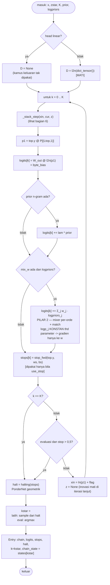
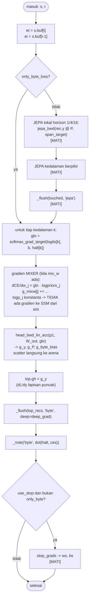
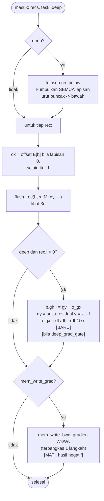
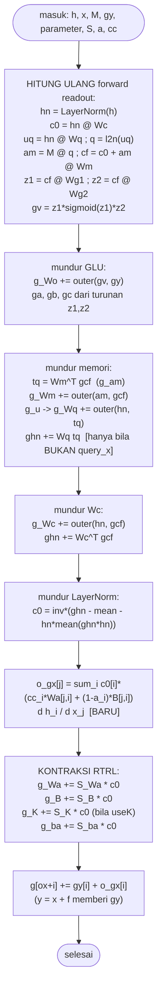
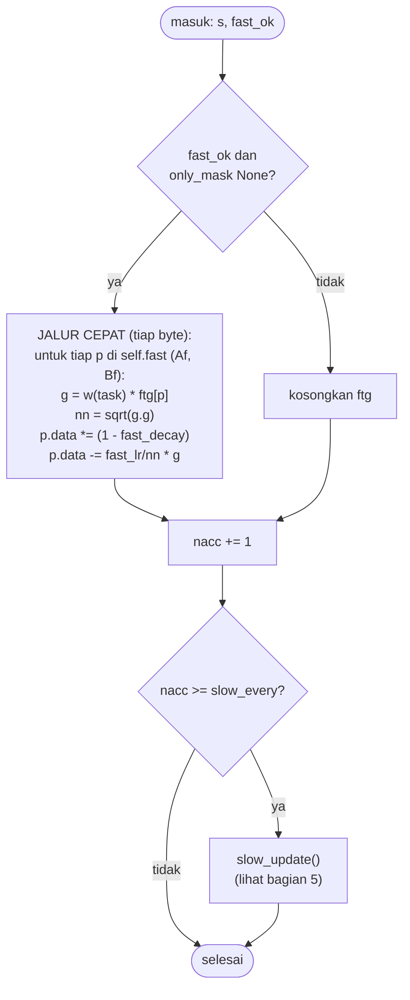
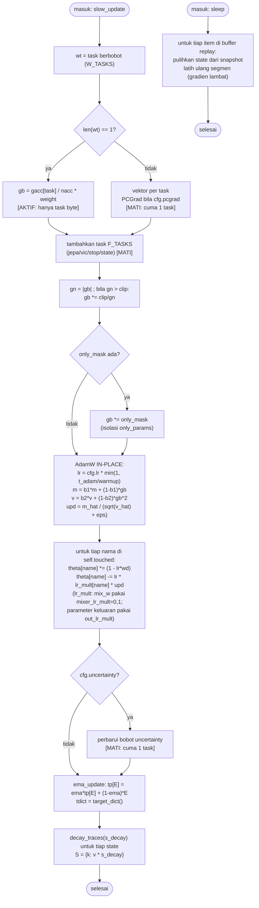
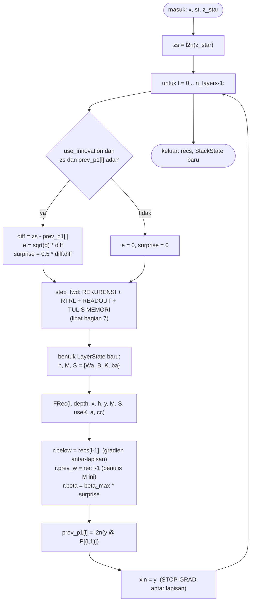
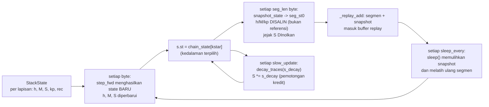

# Flowchart lengkap TMT2

Dari input mentah sampai output dan pembaruan parameter. Semua nama variabel/fungsi diambil
langsung dari kode. Tanda **[AKTIF]** = dipakai di konfigurasi terbaik
(`head="linear"` + `deep_grad` + `only_byte_loss`); **[MATI]** = ada di kode tetapi tidak aktif.

Konfigurasi terbaik: `head="linear"`, `deep_grad=True`, `only_byte_loss=True`, `lr=1e-2`,
`warmup=200`, `mem_query_x=True`, `mem_wq_match_k=True`, `mem_hetero=True`,
`mem_surprise_fixed=True`, `beta_max=1.0`, `deep_grad_gate=True`, `think_prob=0.0`,
**`mixer_k=1` + `mixer_match_orders="1..12"` + `mixer_match=True`** (`Config.best()`).

> **Revisi 2026-10-04.** Jalur MIXER ditambahkan ke diagram — ia membawa **seluruh** kualitas
> (mixer-saja 1,8434 vs SSM-saja 2,9235 vs keduanya 1,8440 pada WikiText 200k). Lihat
> `ARCHITECTURE.md` §1b. Status tes: **77 lolos**.
>
> **Revisi 2026-10-06.** §1–§9 di bawah menggambarkan **TMT2 lama** (SSM + RTRL, `core.py`).
> **Jalur produksi sekarang adalah TMT2 v2 Tingkat A** (`tmt2/stat_core.py`) — alurnya
> **berbeda** dan digambarkan di **§10** di bawah. Status tes: **93 lolos**.

---

## 1. Alur satu byte — input → proses → output

```mermaid
flowchart TD
    START([byte b_t tiba dari stream]) --> PREV["ambil entri sebelumnya<br/>prev = s.buf[s.t]"]
    PREV --> CEPRE["ce_pre = CE(prev.logits, b_t)<br/>prediksi PREKUENSIAL<br/>(dihitung SEBELUM byte diproses)"]
    CEPRE --> ZSTAR["zstar = tdict[b_t]<br/>target encoder (EMA dari E)"]
    ZSTAR --> ENC["x = E[b_t]<br/>encoder: baris ke-b dari tabel E (V x d)"]

    ENC --> NG{"ngram aktif?<br/>ngram_lam &gt; 0 atau ngram_learn"}
    NG -->|ya| NGU["perbarui OnlineNgramN<br/>prior = log P_ngram"]
    NG -->|tidak| MIXQ{"mixer aktif?<br/>m.mix_w tidak None"}
    NGU --> MIXQ
    MIXQ -->|ya| MIXB["PERBARUI TABEL MIXER (SETELAH prediksi -> tanpa bocor)<br/>logpriors = [logprior_order(ctx, o) untuk tiap orde]<br/>+ logprior_match (deterministik, bila mixer_match)<br/>+ logprior_match_recent (indeks K-gram, bila diaktifkan)<br/>catat byte ke s.hist TEPAT SEKALI (flag appended)"]
    MIXQ -->|tidak| THINK
    MIXB --> THINK

    THINK{"think?<br/>rng &lt; think_prob"}
    THINK -->|ya| KMAX["K = think_max"]
    THINK -->|tidak| KZERO["K = 0"]
    KMAX --> CHAIN
    KZERO --> CHAIN

    CHAIN["_chain: tumpukan SSM<br/>+ logits += Σ_j w_j · logpriors_j<br/>(lihat bagian 2)"]
    CHAIN --> ENTRY["Entry e:<br/>chain, logits, stops, halt, k,<br/>zn = l2n(zstar), prior"]
    ENTRY --> PUB["e.byte = b_t<br/>r.byte = b_t untuk routing g_x ke E[b_t]"]
    PUB --> ADV["s.t += 1 ; s.buf[s.t] = e<br/>s.st = e.chain_state"]

    ADV --> TRAIN{"train?"}
    TRAIN -->|ya| RESOLVE["_resolve: hitung loss + backward<br/>(lihat bagian 3)"]
    TRAIN -->|tidak| SKIP["lewati belajar<br/>(eval/generate)"]
    RESOLVE --> AUX{"only_byte_loss?"}
    AUX -->|tidak| AUXL["_state_cap + _vic<br/>[MATI di konfig terbaik]"]
    AUX -->|ya| CONS
    AUXL --> CONS["_consume: perbarui parameter<br/>(lihat bagian 4)"]
    CONS --> GC["buang entri lama:<br/>hapus j &lt; t - maxH - 1"]
    SKIP --> GC
    GC --> OUT

    OUT["OUTPUT: ce_pre<br/>CE prekuensial untuk byte b_t"]
    OUT --> ONLINE{"s.online dan train?"}
    ONLINE -->|ya| SEG["s.seg.append(b_t) ; n_bytes += 1"]
    ONLINE -->|tidak| END([selesai])
    SEG --> SEGFULL{"len(s.seg) &gt;= seg_len?"}
    SEGFULL -->|ya| REPLAY["_replay_add(s)<br/>simpan segmen + snapshot_state<br/>(salinan MANDIRI h/M/kp)"]
    SEGFULL -->|tidak| SLEEPQ
    REPLAY --> SLEEPQ{"n_bytes % sleep_every == 0?"}
    SLEEPQ -->|ya| SLEEP["sleep(): latih ulang item replay<br/>(lihat bagian 5)"]
    SLEEPQ -->|tidak| END
    SLEEP --> END
```



---

## 2. `_chain` — tumpukan + loop berpikir



---

## 3. `_resolve` — loss dan backward



### 3b. `_flush` — backward readout + kontraksi RTRL



### 3c. `flush_rec` — isi satu backward lapisan



---

## 4. `_consume` — pembaruan parameter



---

## 5. `slow_update` + `sleep`



---

## 6. `_stack_step` — satu langkah tumpukan (isi satu lapisan)



---

## 7. `step_fwd` — isi satu langkah lapisan

```mermaid
flowchart TD
    ST0([masuk: x, h_prev, S, parameter, M, kp_prev]) --> REC["REKURENSI:<br/>a_i = sigmoid(sum_j x_j Wa[j,i] + ba_i)<br/>u_i = sum_j x_j B[j,i]<br/>cc_i = (h_prev_i - u_i) * a_i * (1-a_i)"]
    REC --> HNEW["h_i = a_i*h_prev_i + (1-a_i)*u_i"]
    HNEW --> INOVE{"use_e?"}
    INOVE -->|ya| HINOV["h_i += sum_j e_j K[j,i]"]
    INOVE -->|tidak| TRACE
    HINOV --> TRACE["PERBARUI JEJAK RTRL:<br/>S_Wa[j,i] = a_i*S_Wa[j,i] + x_j*cc_i<br/>S_B[j,i]  = a_i*S_B[j,i]  + x_j*(1-a_i)<br/>S_K[j,i]  = a_i*S_K[j,i]  + e_j<br/>S_ba[i]   = a_i*S_ba[i]   + cc_i"]

    TRACE --> LN["READOUT - LayerNorm:<br/>hn = (h - mean(h)) / sqrt(var + eps)"]
    LN --> WC["c = hn @ Wc"]
    WC --> MEMR{"use_memory?"}
    MEMR -->|ya| QR["KUERI BACA:<br/>bila mem_query_x: q = l2n(ln(x) @ Wq)<br/>selain itu: q = l2n(hn @ Wq)"]
    MEMR -->|tidak| GLU
    QR --> AM["am = M @ q<br/>cf = c + am @ Wm"]
    AM --> GLU["GLU:<br/>z1 = cf @ Wg1 ; z2 = cf @ Wg2<br/>gv = z1 * sigmoid(z1) * z2<br/>f = gv @ Wo"]
    GLU --> ADAPT{"use_ad?"}
    ADAPT -->|ya| ADL["f += (cf @ Af) @ Bf"]
    ADAPT -->|tidak| YOUT
    ADL --> YOUT["y = x + f  (residual)"]

    YOUT --> MEMW{"use_memory?"}
    MEMW -->|tidak| SFEND
    MEMW -->|ya| KLN["ln(x) = LayerNorm(x) ; o_kp = ln(x)"]
    KLN --> KV["k = l2n(src @ Wk)  dengan<br/>src = kp_prev (hetero) atau ln(x)<br/>v = ln(x) @ Wv"]
    KV --> BETA["beta = beta_max * min(1, surprise)<br/>atau beta_max bila mem_surprise_fixed"]
    BETA --> DELTA["M <- M + beta * outer(v - M@k, k)<br/>(aturan delta-rule)"]
    DELTA --> SFEND([keluar: h, S, y, M, kp, a, cc])
```



---

## 8. Siklus hidup state



**Peringatan penting:** `snapshot_state` WAJIB menyalin `h`, `M`, `kp`. `_BufPool` adalah ring
buffer — kalau state disimpan sebagai referensi, buffer kolam akan menimpanya sebelum replay
membacanya. Ini pernah jadi bug nyata (lihat `STATUS.md` P0b lama).

---

## 9. Ringkasan titik masuk kode

| tahap | fungsi | berkas |
|---|---|---|
| satu byte | `FastLearner.step` | `fast_learner.py` |
| mixer konteks (tabel + log-prior) | `OnlineNgramN.logprior_order` / `logprior_match` / `logprior_match_recent` | `fast_learner.py` |
| tumpukan + berpikir | `_chain` → `_stack_step` | `fast_learner.py` |
| isi satu lapisan (maju) | `fp.step_fwd` | `fastpath.py` |
| loss + backward | `_resolve` → `_flush` → `fp.flush_rec` | `fast_learner.py`, `fastpath.py` |
| pembaruan parameter | `_consume` → `slow_update` | `fast_learner.py` |
| replay + tidur | `sleep` | `fast_learner.py` |
| acuan kebenaran | `core.layer_step`, `core.stack_step` | `core.py` |
| acuan autograd | `autograd.py` | `autograd.py` |

`tmt2/autograd.py` adalah **definisi kebenaran**; jalur numba wajib diverifikasi terhadapnya
(**77 tes**, eksak ~1e-15).

---

# TMT2 v2 — alur JALUR PRODUKSI (Tingkat A + C)

> Ditambahkan 2026-10-06. Semua nama fungsi dari `tmt2/stat_core.py`. Status tes: **93 lolos**.

## 10. Alur satu byte — Tingkat A (inti statistik biner) + C (mixer/APM)

```
byte b_t (aliran)
   │
   ├─► _push(b)  ──► hist[pos & (HBUF-1)] = b ; pos++      (HBUF = 64 byte riwayat)
   │
   └─► stat_step(b, …, train)        ← SATU panggilan @njit per byte
         │
         ├─ [1] HASH KONTEKS (SEKALI per byte, di LUAR loop bit)
         │      untuk tiap konteks c (orde 1..6,8,12,16,24 + kata + jarang):
         │        hctx[c] = FNV-1a(byte pada pola offset coff[c])
         │        havail[c] = cukup riwayat?
         │
         ├─ [2] MATCH (M2)
         │      mkey = _mix64(FNV-1a(minlen byte terakhir))
         │      msl  = mkey & mmask          (indeks slot match)
         │      mck  = (mkey >> 40) & mck_mask   ← FIX 2026-10-05 (dulu mkey & 255 = bit indeks)
         │      bila mchk[msl] == mck → mpred = mbyte[msl]
         │
         └─ untuk bi = 0..7:                 ← 8 keputusan BINER per byte
               bit = (b >> (7-bi)) & 1
               │
               ├─ [3] LOOKUP TABEL per konteks
               │      key = _mix64(hctx[c] ^ c0*GOLDEN ^ (c+1)*CCTX)  ← FIX 2026-10-05 (tambah c)
               │      sl = key & mask ; ck = (key >> 32) & ck_mask
               │      d = tab[sl]                       (SATU int64: (ck<<32)|(n0<<16)|n1)
               │      bila (d>>32)==ck → st[c] = stretch((n1+0.5)/(n0+n1+1))
               │
               ├─ [4] MASUKAN match (st[nctx]) + neural (st[nctx+1]) + bias
               │
               ├─ [5] MIXER-2 (Tingkat C)
               │      lapis 1: 3 set bobot, dipilih c0 / prev_byte / (prev_byte,c0)
               │      lapis 2: campuran ketiganya, dipilih c0 → pm = sigmoid(dot)
               │
               ├─ [6] APM/SSE 2 tahap (DITERAPKAN saat eval, tabelnya saja yang dibekukan)
               │      pf = (pm + apm1[c0,i] + apm2[prev_byte,c0,i]) / 3
               │
               ├─ [7] CE += -log2(pf atau 1-pf)      ← per BIT; BPB = CE/8
               │
               └─ [8] bila train: perbarui mixer (galat AKHIR), APM, penghitung tab[sl]
                       count_cap → pangkas (a>>1, b>>1) saat jenuh
               c0 = c0*2 + bit            (prefiks biner untuk bit berikutnya)

BPB = rata-rata CE per byte = CE_bits / 8
```

**Titik masuk kode (v2)**

| tahap | fungsi | berkas |
|---|---|---|
| satu byte | `StatCore.step` | `stat_core.py` |
| kernel inti (semua langkah di atas) | `stat_step` | `stat_core.py` |
| konteks (pola offset + kata) | `build_contexts` | `stat_core.py` |
| evaluasi beku (tabel beku, konteks jalan) | `StatCore.eval_stream` | `stat_core.py` |
| generasi (sampel dari pohon biner) | `StatCore.generate` → `_sample_byte` | `stat_core.py` |
| latih 30 jt + generasi | `main` | `scripts/train_gen_big.py` |
| investigasi kurva-U (per blok vs bz2) | `main` | `scripts/diag_blocks.py` |

## 11. Alur Tingkat B (neural paralel-chunk) — modul riset (G2 gagal)

```
byte b_t ──► E[b] (embedding 256×d)
              │
              ├─► RMSNorm
              ├─► SARON  : konv kausal depthwise (k=8) + SiLU + pointwise
              │            state (k-1, d) dibawa antar-chunk   [paritas eksak]
              ├─► GONG   : U_t = λ_t ⊙ U_{t-1} + (1-λ_t) k_t v_tᵀ ; o_t = q_t U_t
              │            λ_t = sigmoid(h·Wl + bl)   ← bl: sebaran τ opsional (tau_spread)
              │            mode "chunk" (latih, matmul) == mode "recurrent" (generasi)
              ├─► gerbang per head (Saron vs Gong)
              ├─► SwiGLU + residual + RMSNorm
              └─► logits = W_out · y   →  p(bit|prefiks) via pohon biner
                                           → satu masukan mixer Tingkat A

Latih: BPTT penuh (rekuren; gradien identik dgn chunkwise). ~1–3 kB/s (numpy float64).
Status: G2 GAGAL @1 jt byte (Δ −0,0005). Generasi runtuh ke tarikan tetap. Modul riset.
```

| tahap | fungsi | berkas |
|---|---|---|
| satu blok (paralel / sekuensial) | `GamelanBlock.forward` | `gamelan/block.py` |
| satu langkah decode | `GamelanBlock.step` | `gamelan/block.py` |
| rekurensi Gong (2 bentuk) | `gong_recurrent` / `gong_chunkwise` | `gamelan/gong.py` |
| konv kausal Saron | `saron_forward` | `gamelan/saron.py` |
| maju + mundur (latih) | `block_forward_cache` / `block_backward` | `gamelan/train.py` |
| integrasi A+B + kontrol | `main` | `scripts/tierb_integrate.py` |
